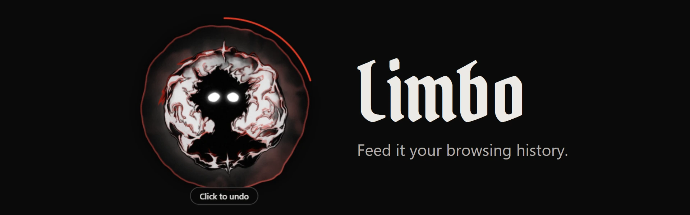
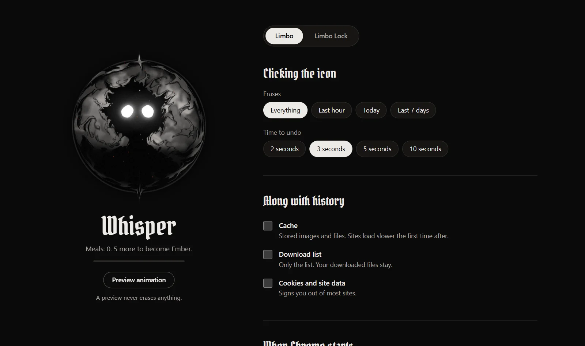
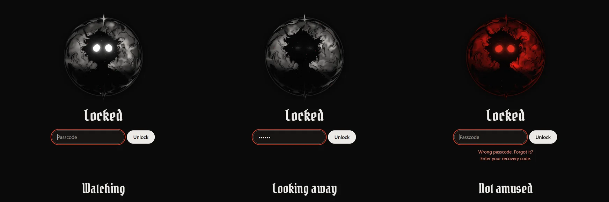
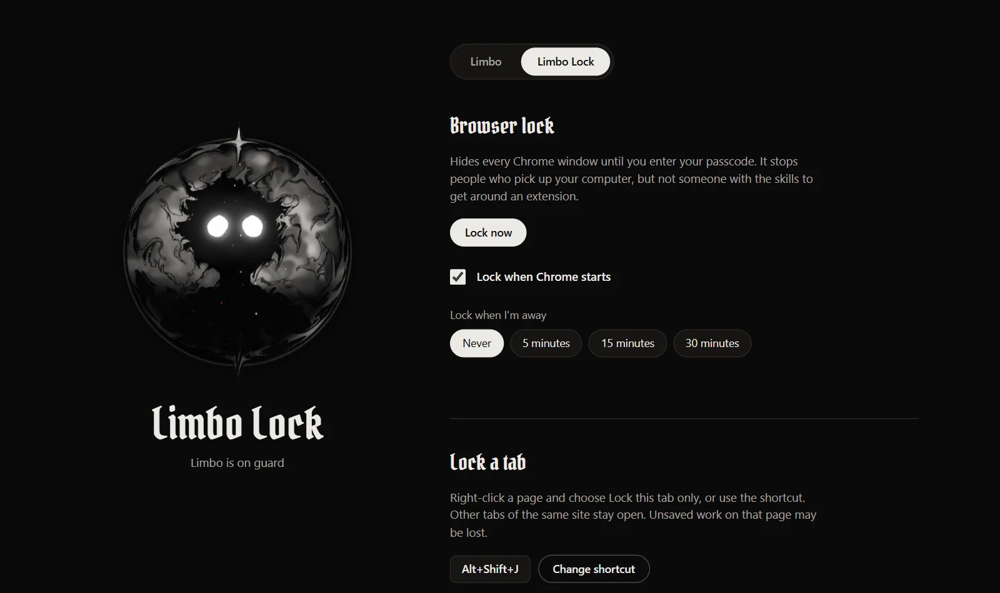
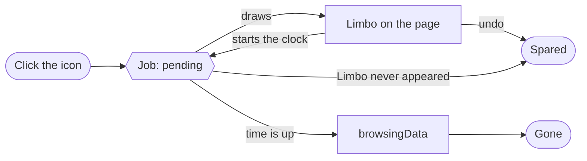

<div align="center">



<br>

[](https://github.com/Hiroyki/limbo/actions/workflows/ci.yml)


### 🕳️ One click. Your history is pulled into the dark.

It can erase your history. It **cannot read** it.

[🚀 Install](#-install) · [🍴 Feed it](#-feed-it) · [🔥 Watch it grow](#-watch-it-grow) · [🔒 Limbo Lock](#-limbo-lock) · [🔐 Privacy](#-privacy-and-permissions) · [🔧 Development](#-development)

<br>

<table>
<tr>
<td align="center"><br><b>Let it feed</b></td>
<td align="center"><br><b>Change your mind</b></td>
</tr>
</table>

</div>

## ✨ What it does

| | |
|---|---|
| 🍴 **Eats history** | Everything, the last hour, today, or the last 7 days |
| ↩️ **Gives you time** | 2, 3, 5 or 10 seconds to undo, with a ring that counts down |
| 🙈 **Reads nothing** | No `history` permission, no tracking, nothing sent anywhere |
| 🔒 **Locks things** | The whole browser, one tab, or a site in every tab |
| 👁️ **Watches you** | Its eyes follow the cursor, and shut while you type a passcode |
| 🔥 **Grows** | Five levels, fed one erase at a time |
| 🔊 **Makes noise** | Optional sound, synthesised on the spot, with no audio files |
| 🌏 **Speaks** | English and Indonesian, following Chrome's language |

## 🚀 Install

1. **Download** this repository (**Code**, then **Download ZIP**) and unzip it, or clone it.
2. Open `chrome://extensions` and turn on **Developer mode**.
3. Choose **Load unpacked** and select the folder that contains `manifest.json`.
4. Click the 🧩 puzzle piece next to the address bar and **pin** Limbo.

Chrome 127 or later is required. The welcome page has a preview that erases nothing, so you can meet Limbo first.

## 🍴 Feed it

| To | Do this |
|---|---|
| Erase history | Click the icon, or press <kbd>Alt</kbd> <kbd>Shift</kbd> <kbd>L</kbd> |
| Undo | Click Limbo, press <kbd>Esc</kbd>, or click the icon again while the red ring is running |
| Erase only part of it | Right-click the icon, then **Erase** |
| See the animation without erasing | **Settings**, then **Preview animation** |
| Change anything else | Right-click the icon, then **Settings and preview** |

Limbo erases nothing if it cannot show itself and its undo button.

<div align="center">

</div>

Settings also cover the cache, the download list, cookies and site data, erasing when Chrome starts, sound, size and position. All of the extra erasing is off until you turn it on.

<details>
<summary>🔎 <b>What about my Google searches?</b></summary>
<br>

Searches saved in a Google account are stored by Google, not by Chrome, so Limbo cannot erase them. **Settings**, then **Google search history**, opens Google's own pages for deleting them or setting up auto-delete.

</details>

<details>
<summary>🌑 <b>Why is it a small square on some pages?</b></summary>
<br>

Chrome's own pages, such as New Tab and the Web Store, do not allow extensions to draw on them. There Limbo opens in a small popup instead of a circle on the page.

</details>

## 🔥 Watch it grow

Every erase is a meal. The fire reddens, the embers multiply, and from Inferno on its eyes begin to smoke.

<div align="center">

</div>

<details>
<summary>🌕 <b>Something rare</b> (spoiler)</summary>
<br>

From Ember on, about one appearance in ten is a blood moon.

<div align="center">

</div>

</details>

## 🔒 Limbo Lock

One passcode for the browser, for single tabs, or for sites. Set it in **Settings**, under the **Limbo Lock** tab, and keep the recovery code: it is shown once.

<div align="center">

</div>

| Lock | How | What happens |
|---|---|---|
| 🖥️ **The browser** | Right-click the icon, then **Lock browser**, or <kbd>Alt</kbd> <kbd>Shift</kbd> <kbd>K</kbd> | Every window is hidden behind a lock screen |
| 📄 **One tab** | Right-click a page, then **Lock this tab only**, or <kbd>Alt</kbd> <kbd>Shift</kbd> <kbd>J</kbd> | The tab shows the lock, and returns to the same page afterwards |
| 🌐 **A site** | Right-click a page, then **Lock this site (all tabs)** | Every tab of the site asks for the passcode, and one passcode opens them all |

- ⏰ The browser also locks when Chrome starts, which can be turned off, and after 5, 15 or 30 minutes away if you choose so.
- 🧱 After five wrong passcodes there is a wait of 30 seconds, which doubles up to 10 minutes.
- 🔁 Pressing Back, typing another address, reloading or duplicating a locked tab leads to the lock again.

<details>
<summary>⚙️ <b>The Limbo Lock settings</b></summary>
<br>
<div align="center">

</div>
</details>

> [!WARNING]
> **What it does not protect against.** Limbo Lock keeps out people who pick up your computer. It is not encryption. Someone who knows how can disable extensions, use another Chrome profile, or read the profile folder on disk. For that, lock the computer itself.

<details>
<summary>📌 <b>Good to know</b></summary>
<br>

- Incognito windows are hidden by the browser lock only after you turn on **Allow in Incognito** for Limbo. Tab and site locks do not work in Incognito.
- When Chrome starts, its window can be visible for a moment before the lock appears, because extensions start after the window does.
- Unsaved work on a page can be lost when its tab is locked.
- If both the passcode and the recovery code are lost, `--disable-extensions` starts Chrome without Limbo.

</details>

## 🔐 Privacy and permissions

Limbo collects nothing and sends nothing. The full text is in the [privacy policy](store/privacy-policy.md).

| Permission | Why |
|---|---|
| `browsingData` | Erase history, and the other kinds of data you tick |
| `activeTab`, `scripting` | Draw the animation and the undo button on the current tab after you click |
| `contextMenus` | The right-click menu |
| `storage` | Settings, the number of erases, locked sites and the passcode hash, all on this computer |
| `offscreen` | Optional sound effects |
| `idle` | Lock after the time away you chose |
| Access to a site, optional | Asked for one site at a time, when you lock that site, so Limbo can tell when it is opened |

🔑 Passcodes and recovery codes are stored as salted PBKDF2-SHA-256 hashes with 600,000 rounds ([lock.js](lock.js)).

## 🔧 Development

No framework and no build step: edit, then reload Limbo in `chrome://extensions`.



| Path | Holds |
|---|---|
| [background.js](background.js) | Erase jobs, menus, shortcuts, messages |
| [lock.js](lock.js), [tablock.js](tablock.js) | Browser lock; tab and site locks |
| [settings.js](settings.js) | Defaults, ranges and levels, shared by the worker and the pages |
| [ui/limbo.js](ui/limbo.js), [ui/shader.js](ui/shader.js) | The animation: timeline and input, and the WebGL scene |
| [ui/speaker.js](ui/speaker.js) | Sound effects, synthesised with Web Audio |
| `ui/options.*`, `ui/welcome.*`, `ui/lock.*` | The pages |
| [_locales](_locales) | English and Indonesian text |
| [tests](tests), [tools](tools), [store](store) | Smoke test, packing script, Web Store text and images |

**🧪 Test.** Needs Node 22 or later and Chrome. Limbo is loaded into a throwaway profile, so your own history is not touched. Set `CHROME` to use another Chrome binary, or `HEADFUL=1` to watch.

```sh
node tests/smoke.mjs
```

**📦 Pack.** Checks that both languages define the same messages and writes `store/limbo-<version>.zip`. The steps for publishing are in [store/listing.md](store/listing.md).

```sh
python tools/build.py
```

**🌏 Translate.** Copy `_locales/en` to a new [locale code](https://developer.chrome.com/docs/extensions/reference/api/i18n#locales), translate the `message` values, and keep every key. Then add the code in [ui/i18n.js](ui/i18n.js), which sets the language of the pages.

## 📜 License

The code and artwork have no open-source license. The Pirata One font is under the [SIL Open Font License](ui/fonts/OFL-PirataOne.txt).

<div align="center">
<br>

<br>
<sub>It is watching your cursor.</sub>
</div>
