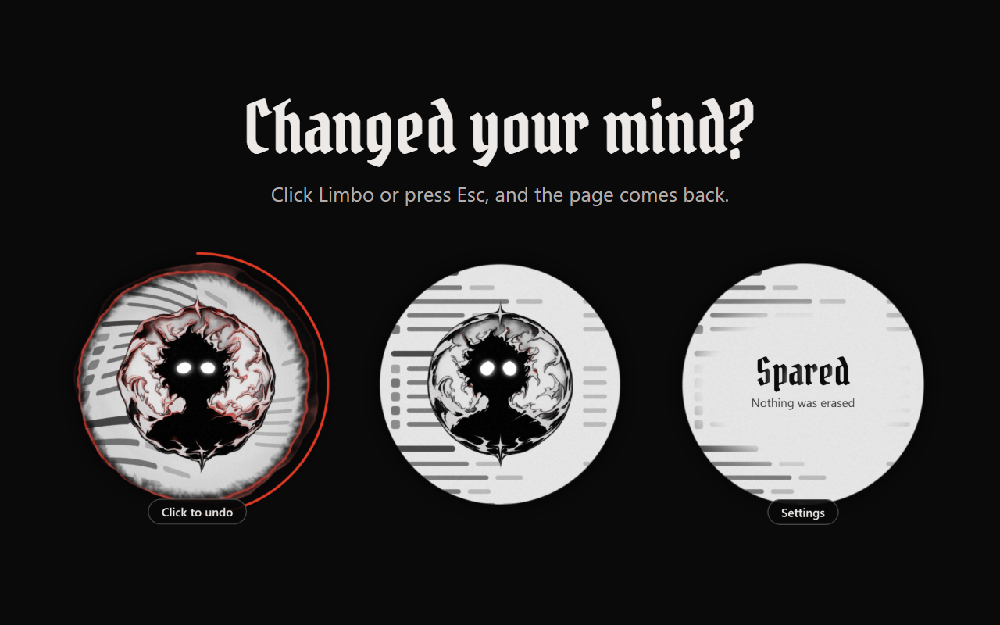

<div align="center">


# Limbo: History Eater

A Chrome extension that eats your browsing history, with time to change your mind.

[](https://github.com/Hiroyki/limbo/actions/workflows/ci.yml)


[Install](#install) · [Use](#use) · [Limbo Lock](#limbo-lock) · [Permissions](#permissions) · [Development](#development)

</div>

Limbo erases history without being able to read it: it does not ask for Chrome's `history` permission. It collects nothing and sends nothing; see the [privacy policy](store/privacy-policy.md).

## Install

Limbo is installed from source.

1. Download this repository (**Code**, then **Download ZIP**) and unzip it, or clone it.
2. Open `chrome://extensions` and turn on **Developer mode**.
3. Choose **Load unpacked** and select the folder that contains `manifest.json`.
4. Click the puzzle piece next to the address bar and pin Limbo.

Chrome 127 or later is required. The welcome page has a preview that erases nothing.

## Use

| To | Do this |
|---|---|
| Erase history | Click the icon, or press `Alt+Shift+L` |
| Undo | Click Limbo, press `Esc`, or click the icon again while the red ring is running |
| Erase only part of it | Right-click the icon, then **Erase**: last hour, today, or last 7 days |
| See the animation without erasing | **Settings**, then **Preview animation** |
| Change anything else | Right-click the icon, then **Settings and preview** |

The time to undo is 3 seconds by default and can be 2, 3, 5 or 10. Limbo erases nothing if it cannot show itself and its undo button.

Settings also cover the cache, the download list, cookies and site data, erasing when Chrome starts, sound, size and position. All of the extra erasing is off until you turn it on.

<div align="center">

</div>

Limbo grows as it is fed, from Whisper through Ember, Wraith and Inferno to Abyss at 100 erases.

### Google searches

Searches saved in a Google account are stored by Google, not by Chrome, so Limbo cannot erase them. **Settings**, then **Google search history**, opens Google's own pages for deleting them or setting up auto-delete.

## Limbo Lock

Limbo Lock puts a passcode on the browser, on single tabs, or on sites. Set the passcode in **Settings**, under the **Limbo Lock** tab, and keep the recovery code: it is shown once.

| Lock | How | What happens |
|---|---|---|
| The browser | Right-click the icon, then **Lock browser**, or `Alt+Shift+K` | Every window is hidden behind a lock screen |
| One tab | Right-click a page, then **Lock this tab only**, or `Alt+Shift+J` | The tab shows the lock, and returns to the same page afterwards |
| A site | Right-click a page, then **Lock this site (all tabs)** | Every tab of the site asks for the passcode, and one passcode opens them all |

The browser also locks when Chrome starts, which can be turned off, and after 5, 15 or 30 minutes away if you choose so. After five wrong passcodes there is a wait of 30 seconds, which doubles up to 10 minutes.

### What it does not protect against

Limbo Lock keeps out people who pick up your computer. It is not encryption. Someone who knows how can disable extensions, use another Chrome profile, or read the profile folder on disk. For that, lock the computer itself.

- Incognito windows are hidden by the browser lock only after you turn on **Allow in Incognito** for Limbo. Tab and site locks do not work in Incognito.
- When Chrome starts, its window can be visible for a moment before the lock appears, because extensions start after the window does.
- Unsaved work on a page can be lost when its tab is locked.
- If both the passcode and the recovery code are lost, `--disable-extensions` starts Chrome without Limbo.

## Permissions

| Permission | Why |
|---|---|
| `browsingData` | Erase history, and the other kinds of data you tick |
| `activeTab`, `scripting` | Draw the animation and the undo button on the current tab after you click |
| `contextMenus` | The right-click menu |
| `storage` | Settings, the number of erases, locked sites and the passcode hash, all on this computer |
| `offscreen` | Optional sound effects |
| `idle` | Lock after the time away you chose |
| Access to a site, optional | Asked for one site at a time, when you lock that site, so Limbo can tell when it is opened |

Passcodes and recovery codes are stored as salted PBKDF2-SHA-256 hashes with 600,000 rounds ([lock.js](lock.js)).

Chrome's own pages, such as New Tab and the Web Store, do not allow extensions to draw on them. There Limbo opens in a small popup instead of a circle on the page.

## Development

There is no build step for running Limbo: edit, then reload it in `chrome://extensions`.

| Path | Holds |
|---|---|
| [background.js](background.js) | Erase jobs, menus, shortcuts, messages |
| [lock.js](lock.js), [tablock.js](tablock.js) | Browser lock; tab and site locks |
| [settings.js](settings.js) | Defaults, ranges and levels, shared by the worker and the pages |
| [ui/limbo.js](ui/limbo.js), [ui/shader.js](ui/shader.js) | The animation: timeline and input, and the WebGL scene |
| [ui/speaker.js](ui/speaker.js) | Sound effects, synthesised with Web Audio |
| `ui/options.*`, `ui/welcome.*`, `ui/lock.*` | The pages |
| [_locales](_locales) | English and Indonesian text |
| [tests](tests), [tools](tools), [store](store) | Smoke test, packing script, Web Store text and images |

### Test

```sh
node tests/smoke.mjs
```

The test needs Node 22 or later and Chrome. It loads Limbo into a throwaway profile, so your own history is not touched. Set `CHROME` to use another Chrome binary, or `HEADFUL=1` to watch.

### Pack

```sh
python tools/build.py
```

This checks that both languages define the same messages and writes `store/limbo-<version>.zip`. The steps for publishing are in [store/listing.md](store/listing.md).

### Translate

Copy `_locales/en` to a new [locale code](https://developer.chrome.com/docs/extensions/reference/api/i18n#locales), translate the `message` values, and keep every key. Then add the code in [ui/i18n.js](ui/i18n.js), which sets the language of the pages.

## License

The code and artwork have no open-source license. The Pirata One font is under the [SIL Open Font License](ui/fonts/OFL-PirataOne.txt).
