<div align="center">


<picture>
<source media="(prefers-color-scheme: dark)" srcset="docs/h-limbo-dark.webp">

</picture>

**A Chrome extension that eats your browsing history.**<br>
One click to feed it. A few seconds to change your mind.

[](https://github.com/Hiroyki/limbo/actions/workflows/ci.yml)

[](https://github.com/Hiroyki/limbo/releases/latest)
[](https://github.com/Hiroyki/limbo/stargazers)


[Will you feed it?](#choose) &nbsp;&middot;&nbsp; [How to install](#install) &nbsp;&middot;&nbsp; [Feed it](#feed) &nbsp;&middot;&nbsp; [Watch it grow](#grow) &nbsp;&middot;&nbsp; [Its moods](#moods) &nbsp;&middot;&nbsp; [Limbo Lock](#lock) &nbsp;&middot;&nbsp; [What it can see](#trust) &nbsp;&middot;&nbsp; [Take it apart](#build)

<br>

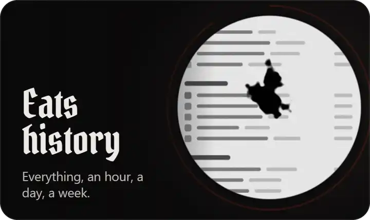
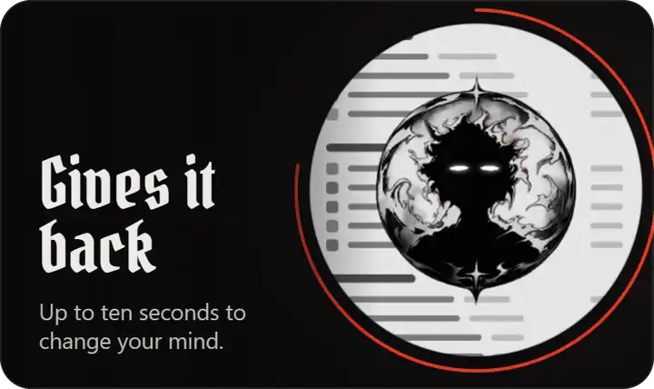
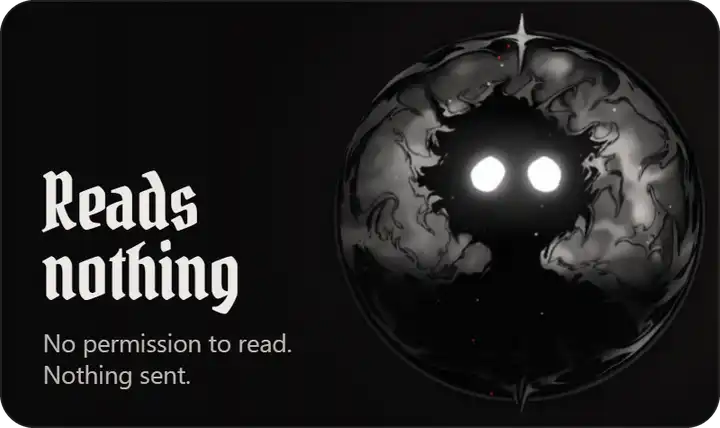
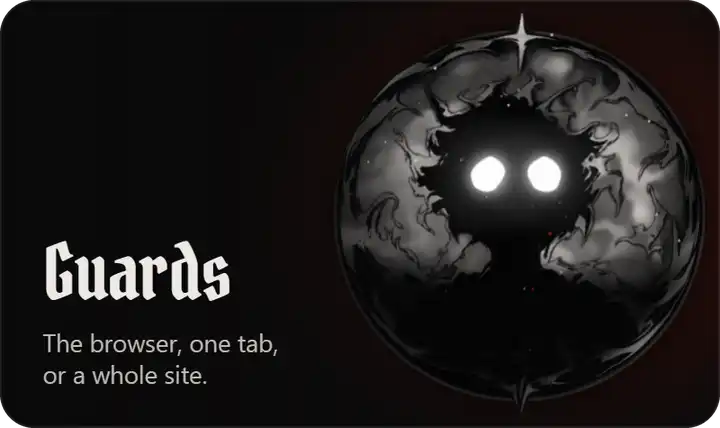
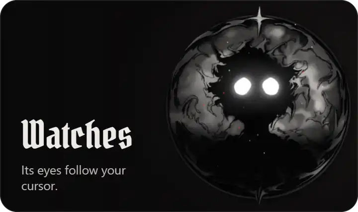
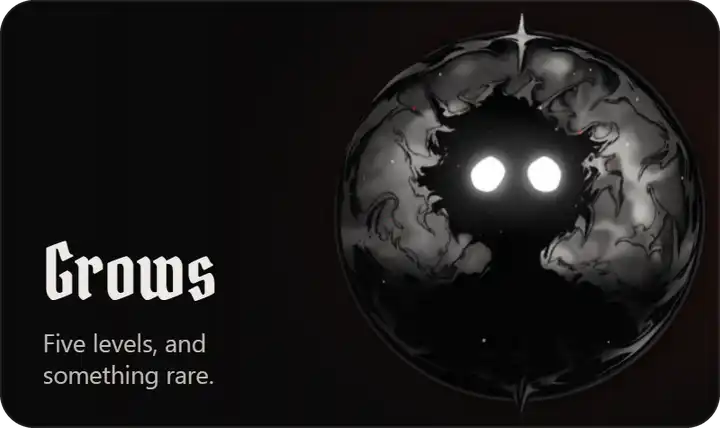

</div>

<br>

<h2 align="center" id="choose">
<picture>
<source media="(prefers-color-scheme: dark)" srcset="docs/h-choose-dark.webp">

</picture>
</h2>

<div align="center">

*A page of everywhere you have been lies open. Something is standing in the middle of it.*<br>
*It looks up.*

</div>

<details>
<summary><b>Feed it.</b></summary>
<br>
<div align="center">

<br>
<i>It is gone. Chrome has erased it, and nothing brings it back.</i>
</div>
</details>

<details>
<summary><b>Wait. Not yet.</b></summary>
<br>
<div align="center">

<br>
<i>It coughs the page back up. Not a line is missing.</i>
</div>
</details>

<details>
<summary><b>Poke it.</b></summary>
<br>
<div align="center">

<br>
<i>It blinks, and the smoke ripples. It had been watching your cursor the whole time.</i>
</div>
</details>

<div align="center">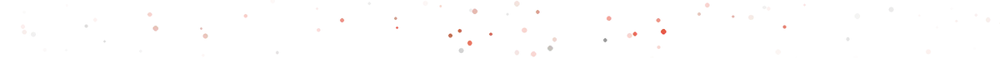</div>

<h2 align="center" id="install">
<picture>
<source media="(prefers-color-scheme: dark)" srcset="docs/h-install-dark.webp">

</picture>
</h2>

<div align="center">
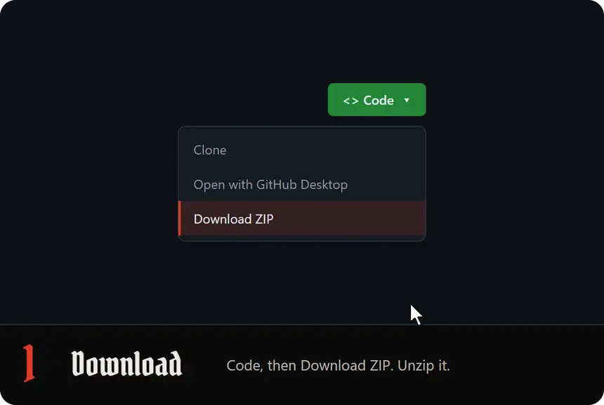
</div>

1. **Download** the ZIP from the [latest release](https://github.com/Hiroyki/limbo/releases/latest), or choose **Code**, then **Download ZIP** on this page. Unzip it somewhere it can stay.
2. **Open.** Go to `chrome://extensions` and turn on **Developer mode** in the top right corner.
3. **Load.** Choose **Load unpacked** and select the folder that contains `manifest.json`.
4. **Meet.** A welcome page opens. Click the puzzle piece next to the address bar and pin Limbo.

Chrome 127 or later is required. The welcome page has a preview that erases nothing, so you can meet Limbo first.

<details>
<summary><b>Install with Git</b></summary>
<br>

```sh
git clone https://github.com/Hiroyki/limbo.git
```

Then continue from step 2 and select the `limbo` folder.

</details>

<details>
<summary><b>Update</b></summary>
<br>

Replace the files in the same folder, or run `git pull`. Then press the reload arrow on Limbo's card in `chrome://extensions`. Your settings, level and passcode stay.

</details>

<details>
<summary><b>It does not load</b></summary>
<br>

| What you see | What to do |
|---|---|
| Manifest file is missing or unreadable | You selected the folder around it. Select the one that contains `manifest.json` |
| Limbo disappears after a while | Chrome reads Limbo from its folder every time. Do not move or delete the folder |
| A shortcut does nothing | Another extension may use it. Change it at `chrome://extensions/shortcuts` |
| Two Limbos | Remove one of them in `chrome://extensions` |

</details>

<details>
<summary><b>Remove</b></summary>
<br>

Press **Remove** on Limbo's card in `chrome://extensions`. This also deletes everything it stored.

</details>

<div align="center"></div>

<h2 align="center" id="feed">
<picture>
<source media="(prefers-color-scheme: dark)" srcset="docs/h-feed-dark.webp">

</picture>
</h2>
<div align="center">
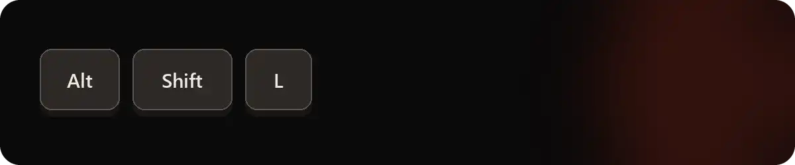
</div>


| To | Do this |
|---|---|
| Erase history | Click the icon, or press <kbd>Alt</kbd> <kbd>Shift</kbd> <kbd>L</kbd> |
| Undo | Click Limbo, press <kbd>Esc</kbd>, or click the icon again while the red ring is running |
| Erase only part of it | Right-click the icon, then **Erase** |
| See the animation without erasing | **Settings**, then **Preview animation** |
| Change anything else | Right-click the icon, then **Settings and preview** |

Limbo erases nothing if it cannot show itself and its undo button.

#### On the menu

| Dish | Served |
|---|---|
| Browsing history | Always: all of it, the last hour, today, or the last 7 days |
| Cache | If you tick it |
| Download list | If you tick it. The files stay |
| Cookies and site data | If you tick it. Signs you out of most sites |
| Passwords, bookmarks, autofill | Never |

<details>
<summary><b>The settings</b></summary>
<br>
<div align="center">

</div>
</details>

<details>
<summary><b>What about my Google searches?</b></summary>
<br>

Searches saved in a Google account are stored by Google, not by Chrome, so Limbo cannot erase them. **Settings**, then **Google search history**, opens Google's own pages for deleting them or setting up auto-delete.

</details>

<details>
<summary><b>Why is it a small square on some pages?</b></summary>
<br>

Chrome's own pages, such as New Tab and the Web Store, do not allow extensions to draw on them. There Limbo opens in a small popup instead of a circle on the page.

</details>

<div align="center"></div>

<h2 align="center" id="grow">
<picture>
<source media="(prefers-color-scheme: dark)" srcset="docs/h-grow-dark.webp">

</picture>
</h2>

<div align="center">

Every erase is a meal. The fire reddens, the embers multiply, and from Inferno on its eyes begin to smoke.

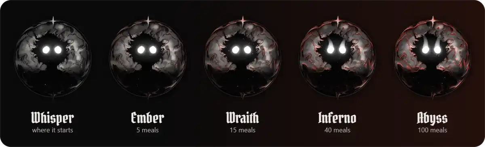

</div>

<div align="center"></div>

<h2 align="center" id="moods">
<picture>
<source media="(prefers-color-scheme: dark)" srcset="docs/h-moods-dark.webp">

</picture>
</h2>

<div align="center">
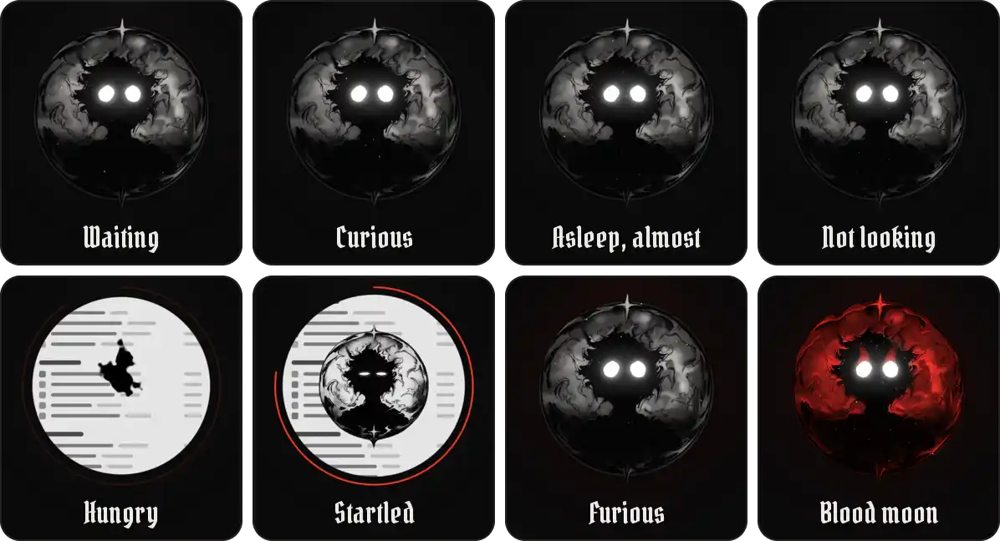

Most of these you will meet. The last one is rare: from Ember on, about one appearance in ten.

</div>

<div align="center"></div>

<h2 align="center" id="lock">
<picture>
<source media="(prefers-color-scheme: dark)" srcset="docs/h-lock-dark.webp">

</picture>
</h2>

<div align="center">

One passcode for the browser, for single tabs, or for sites.<br>
Limbo watches, looks away while you type, and does not take wrong answers well.

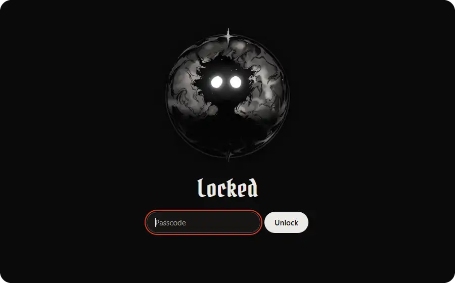

</div>

| Lock | How | What happens |
|---|---|---|
| **The browser** | Right-click the icon, then **Lock browser**, or <kbd>Alt</kbd> <kbd>Shift</kbd> <kbd>K</kbd> | Every window is hidden behind a lock screen |
| **One tab** | Right-click a page, then **Lock this tab only**, or <kbd>Alt</kbd> <kbd>Shift</kbd> <kbd>J</kbd> | The tab shows the lock, and returns to the same page afterwards |
| **A site** | Right-click a page, then **Lock this site (all tabs)** | Every tab of the site asks for the passcode, and one passcode opens them all |

Set the passcode in **Settings**, under the **Limbo Lock** tab, and keep the recovery code: it is shown once. The browser also locks when Chrome starts, which can be turned off, and after 5, 15 or 30 minutes away if you choose so. After five wrong passcodes there is a wait of 30 seconds, which doubles up to 10 minutes.

> [!WARNING]
> Limbo Lock keeps out people who pick up your computer. It is not encryption. Someone who knows how can disable extensions, use another Chrome profile, or read the profile folder on disk. For that, lock the computer itself.

<details>
<summary><b>The Limbo Lock settings</b></summary>
<br>
<div align="center">

</div>
</details>

<details>
<summary><b>Good to know</b></summary>
<br>

- Pressing Back, typing another address, reloading or duplicating a locked tab leads to the lock again.
- Incognito windows are hidden by the browser lock only after you turn on **Allow in Incognito** for Limbo. Tab and site locks do not work in Incognito.
- When Chrome starts, its window can be visible for a moment before the lock appears, because extensions start after the window does.
- Unsaved work on a page can be lost when its tab is locked.
- If both the passcode and the recovery code are lost, `--disable-extensions` starts Chrome without Limbo.

</details>

<div align="center"></div>

<h2 align="center" id="trust">
<picture>
<source media="(prefers-color-scheme: dark)" srcset="docs/h-trust-dark.webp">

</picture>
</h2>

<div align="center">

**Not your history.** Limbo asks Chrome to erase it, without the permission to read it.<br>
It collects nothing and sends nothing. The full text is in the [privacy policy](store/privacy-policy.md).

</div>

<details>
<summary><b>Every permission, and why</b></summary>
<br>

| Permission | Why |
|---|---|
| `browsingData` | Erase history, and the other kinds of data you tick |
| `activeTab`, `scripting` | Draw the animation and the undo button on the current tab after you click |
| `contextMenus` | The right-click menu |
| `storage` | Settings, the number of erases, locked sites and the passcode hash, all on this computer |
| `offscreen` | Optional sound effects |
| `idle` | Lock after the time away you chose |
| Access to a site, optional | Asked for one site at a time, when you lock that site, so Limbo can tell when it is opened |

Passcodes and recovery codes are stored as salted PBKDF2-SHA-256 hashes with 600,000 rounds ([lock.js](lock.js)).

</details>

<div align="center"></div>

<h2 align="center" id="build">
<picture>
<source media="(prefers-color-scheme: dark)" srcset="docs/h-build-dark.webp">

</picture>
</h2>

No framework and no build step: edit, then reload Limbo in `chrome://extensions`. Its text is in English and Indonesian, and its sounds are synthesised, with no audio files.


```sh
node tests/smoke.mjs      # test, in a throwaway Chrome profile
python tools/build.py     # pack store/limbo-<version>.zip
```

<details>
<summary><b>Where things are</b></summary>
<br>

| Path | Holds |
|---|---|
| [background.js](background.js) | Erase jobs, menus, shortcuts, messages |
| [lock.js](lock.js), [tablock.js](tablock.js) | Browser lock; tab and site locks |
| [settings.js](settings.js) | Defaults, ranges and levels, shared by the worker and the pages |
| [ui/limbo.js](ui/limbo.js), [ui/shader.js](ui/shader.js) | The animation: timeline and input, and the WebGL scene |
| [ui/speaker.js](ui/speaker.js) | Sound effects, synthesised with Web Audio |
| `ui/options.*`, `ui/welcome.*`, `ui/lock.*` | The pages |
| [_locales](_locales) | English and Indonesian text |
| [tests](tests), [tools](tools), [store](store) | Smoke test, packing script, Web Store text and images |

</details>

<details>
<summary><b>Testing, packing and translating</b></summary>
<br>

The test needs Node 22 or later and Chrome. It loads Limbo into a throwaway profile, so your own history is not touched. Set `CHROME` to use another Chrome binary, or `HEADFUL=1` to watch.

Packing checks that both languages define the same messages. The steps for publishing are in [store/listing.md](store/listing.md).

To translate, copy `_locales/en` to a new [locale code](https://developer.chrome.com/docs/extensions/reference/api/i18n#locales), translate the `message` values, and keep every key. Then add the code in [ui/i18n.js](ui/i18n.js), which sets the language of the pages.

</details>

<br>

<div align="center">


<b>Still here?</b> It noticed. <a href="https://github.com/Hiroyki/limbo/stargazers">Leave it a star</a>, or <a href="https://github.com/Hiroyki/limbo/issues">tell it what is wrong</a>.

<sub>The code and artwork have no open-source license. Pirata One is under the <a href="ui/fonts/OFL-PirataOne.txt">SIL Open Font License</a>.</sub>

</div>
